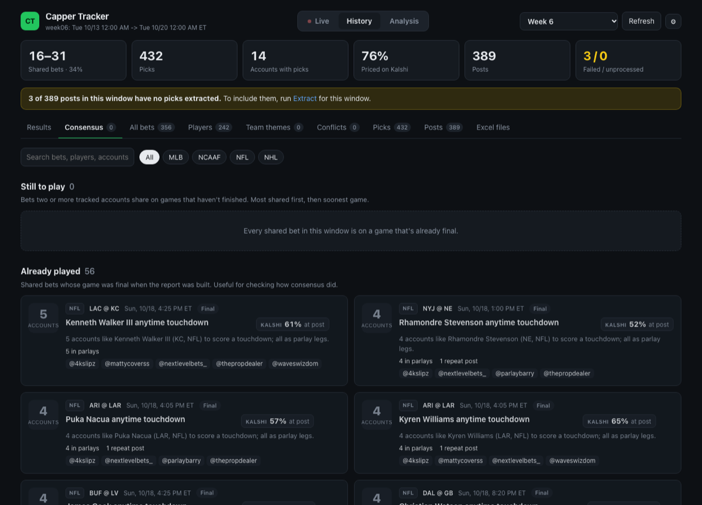
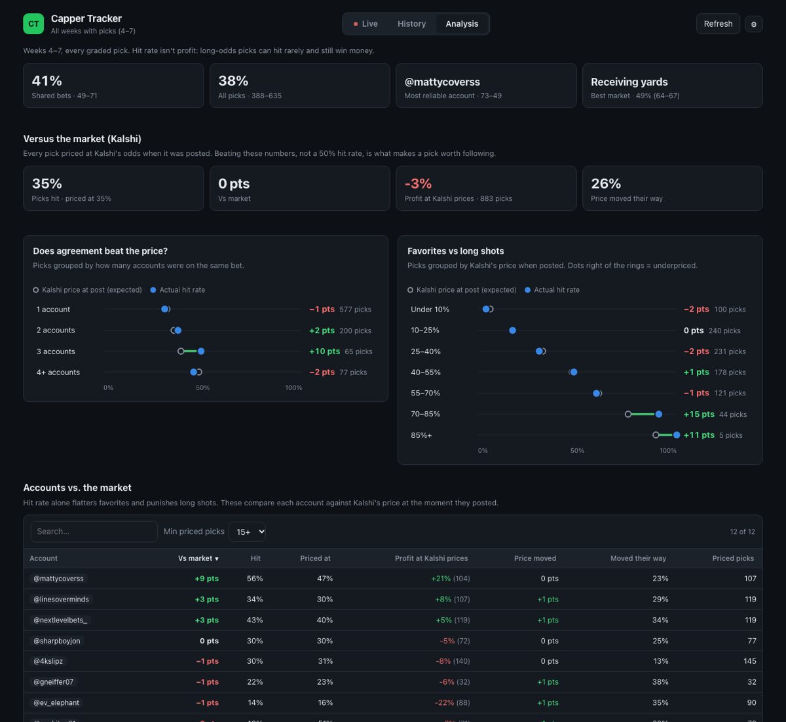

# Capper Tracker

**Follow a group of sports bettors ("cappers") on X, see which bets they agree on, and find out who actually wins.**

Every week, Capper Tracker:

1. **Collects** the latest posts from a list of X (Twitter) accounts you choose.
2. **Reads** each post, including screenshots of bet slips, using Claude (an AI model), and turns it into a clean list of bets: "Ja'Marr Chase over 74.5 receiving yards", "Chiefs -3.5", and so on.
3. **Finds the consensus**: bets that several accounts posted independently, ranked by how many agree.
4. **Grades** every bet once the game is over, using official box scores, so you can see who hits and whether following the crowd pays off.

You use it through a web page on your own computer, or as a spreadsheet report that's generated automatically.



---

## Contents

- [What you'll see](#what-youll-see)
- [What you need](#what-you-need)
- [Setup (one time)](#setup-one-time)
- [Everyday use](#everyday-use)
- [How to read the numbers](#how-to-read-the-numbers)
- [Glossary](#glossary)
- [What it costs](#what-it-costs)
- [Troubleshooting](#troubleshooting)
- [How it works under the hood](#how-it-works-under-the-hood)
- [Known limitations](#known-limitations)

---

## What you'll see

The web app has these tabs:

| Tab | What it shows |
|---|---|
| **Consensus** | Bets that 2+ accounts posted on games that haven't been played yet, most-shared first. Each card explains the bet in plain English, shows the game and kickoff time, and lists who posted it. |
| **Results** | How the selected week turned out: each shared bet marked Won/Lost with what actually happened ("74 rec yds", "2 TDs"), plus each account's record. |
| **Trends** | All weeks together: who hits most reliably, which kinds of bets hit, and whether agreement between accounts helps. |
| **Team themes** | NFL only. Which teams the accounts expect to throw a lot vs. run a lot, based on the player props they're betting. |
| **Players** | Every player anyone bet on, and whether accounts lean over or under. |
| **All bets** | Every bet, including ones only one account posted. |
| **Conflicts** | Bets where tracked accounts are on opposite sides. |
| **Picks / Posts** | The raw material: every extracted bet with a link to the original post, and every post with how it was classified. Useful for double-checking. |
| **Guide** | Definitions of every term and column. |
| **Run & accounts** | Add or remove tracked accounts, and run the weekly update with a button. |




---

## What you need

| Thing | Why | Where to get it |
|---|---|---|
| A Mac (or Linux) computer | Runs everything locally. Automatic scheduling is set up for macOS. | |
| **Python 3.10 or newer** | Runs the tracker. | [python.org](https://www.python.org/downloads/) or [Anaconda](https://www.anaconda.com/download) |
| **Node.js 18 or newer** | Only needed once, to build the web page. | [nodejs.org](https://nodejs.org/), or `brew install node`, or `conda install -c conda-forge nodejs` |
| **An X API bearer token**, with pay-per-use credits | To read posts from X. | [developer.x.com](https://developer.x.com/) → create a project and app → copy the *Bearer Token* |
| **An Anthropic API key** | To read the posts and bet slips. | [console.anthropic.com](https://console.anthropic.com/) → API Keys |

Game schedules, scores and box scores come from ESPN's public feeds. No account is needed for those.

---

## Setup (one time)

Open Terminal and run these steps one at a time.

**1. Download the project**

```bash
git clone https://github.com/par55555/capper-tracker.git
cd capper-tracker
```

**2. Create a Python environment and install the requirements**

Using Anaconda (recommended):

```bash
conda create -n capper python=3.12 -y
conda activate capper
pip install -r requirements.txt
```

Or with plain Python: `python3 -m venv .venv && source .venv/bin/activate && pip install -r requirements.txt`

> Each time you open a new Terminal window to use the tracker, run `conda activate capper` (or `source .venv/bin/activate`) first.

**3. Add your API keys**

```bash
cp .env.example .env
open -e .env        # opens it in TextEdit
```

Paste your keys after the `=` signs, with no quotes and no spaces:

```
X_BEARER_TOKEN=AAAAAAAAAAAAAAAAAAAAA...
ANTHROPIC_API_KEY=sk-ant-...
```

The other settings in that file have sensible defaults (see [Settings](#settings)). The `.env` file stays on your computer; it's excluded from git, so your keys are never uploaded.

**4. Choose the accounts to track**

Edit `accounts.txt`: one X handle per line, without the `@`. You can also do this later on the web page's **Run & accounts** tab.

**5. Build the web page**

```bash
cd web
npm install
npm run build
cd ..
```

**6. Check that everything works**

```bash
python -m pytest -q tests
```

This runs the built-in tests with fake data. It costs nothing and needs no internet. You should see `passed` at the end.

---

## Everyday use

### Open the web app

```bash
python -m capper_tracker.server
```

Then open **http://127.0.0.1:8000** in your browser. Leave the Terminal window open while you use it; press **Ctrl+C** in it to stop.

Use the dropdown at the top right to switch between NFL weeks, or to look at the last 3, 7 or 14 days.

### Get this week's picks

On the **Run & accounts** tab, choose **Full run** and press **Start**. You'll see its progress live. This:

1. fetches new posts from X (costs money; see [What it costs](#what-it-costs)),
2. sends new posts to Claude to pull out the bets (costs money),
3. rebuilds the report (free).


Runs only pay for posts they haven't seen before, so running again later in the week is cheap. The other buttons do one step at a time, for example **Report only** to refresh the report for free.

The same steps are available from Terminal:

```bash
python -m capper_tracker run               # this NFL week so far (since Tuesday)
python -m capper_tracker run --week 5      # a specific past NFL week
python -m capper_tracker run --days 7      # the last 7 days, regardless of NFL weeks
python -m capper_tracker report            # just rebuild the report (free)
python -m capper_tracker extract           # retry posts that failed to be read
```

Each run also saves a spreadsheet. The newest one is always at `exports/latest_consensus.xlsx`, with dated copies next to it.

### Run it automatically twice a week (Mac)

```bash
python -m capper_tracker.schedule install    # every Thursday 12:00 and Sunday 11:00
python -m capper_tracker.schedule run-now    # try it once right now
python -m capper_tracker.schedule status     # did the last one work?
python -m capper_tracker.schedule uninstall  # turn it off
```

Run `install` with your `capper` environment active; the schedule uses that environment. After each run you get a Mac notification with the top shared bets, or an alert if something went wrong.

- If the Mac is **asleep** at the scheduled time, the run happens when it wakes up. If it's **shut down**, that run is skipped.
- Not seeing notifications? System Settings → Notifications → allow **Script Editor**.
- On Linux, use cron instead: `0 12 * * 4` and `0 11 * * 0`, running `python -m capper_tracker run`.

### Which posts count for "this week"?

NFL weeks run **Tuesday to Monday** (Eastern time). A Thursday run sees posts since Tuesday; a Sunday run sees everything since Tuesday. That covers every pick for this week's games without mixing in last week's, which are already settled.

---

## How to read the numbers

**Each account gets one vote per bet.**
- If someone posts the same bet several times (a reminder, a repost, the same leg in several parlays, or at an updated line), it still counts once.
- If someone switches sides (over, then later under), only their latest side counts.

**Bets are grouped regardless of the exact line.** "Chase over 74.5 yards" and "Chase over 79.5 yards" are the same bet; the card shows the range of lines posted.

**Grading** (Results and Trends tabs):
- A bet is graded once ESPN marks its game **Final**.
- **Graded:** NFL and college football player props (yards, receptions, touchdowns, anytime / 2+ / first TD scorer, and more), plus moneylines, spreads, game totals and team totals in every league.
- **Ungraded, with the reason shown:** player props in other sports and unusual custom bets.
- A player who didn't play is shown as ungraded, matching how sportsbooks usually void those bets.

**Hit rate** = wins ÷ (wins + losses). Pushes and ungraded bets are left out.

**Hit rate is not profit.** An anytime-TD bet at +400 only needs to win about 20% of the time to break even. Where accounts posted their odds, the Trends tab shows the **break-even** rate those odds require, and the **flat 1u P/L**: the profit or loss from betting 1 unit on each.

**The 95% range** (the thin line on the Trends bars) shows how much to trust a hit rate. 4–1 and 40–10 are both 80%, but the second is far more convincing. "Most reliable" ranks accounts by the low end of that range, so a lucky small sample can't top the list.

---

## Glossary

| Term | Meaning |
|---|---|
| **Capper** | Someone who posts betting picks publicly. |
| **Consensus / shared bet** | A bet that 2 or more tracked accounts posted. |
| **Prop (player prop)** | A bet on one player's stats, e.g. over 74.5 receiving yards. |
| **Anytime TD** | The player scores a touchdown at any point in the game. |
| **Spread** | A team must win by more than (or lose by less than) a number of points, e.g. -3.5. |
| **Moneyline** | A team simply has to win. |
| **Total (over/under)** | Combined points scored by both teams, over or under a number. |
| **Parlay / parlay leg** | Several bets combined into one; each bet inside is a *leg*. Legs are graded individually here. |
| **Push** | Exactly on the line: the bet is refunded. |
| **Split** | Accounts posted the same bet at different lines, and some won while others lost. |
| **Odds (+150 / -110)** | +150 wins $150 on a $100 bet; -110 risks $110 to win $100. |
| **Unit (u)** | A standard bet size, so results compare fairly across people. |
| **1H / 1Q / 2H** | First half, first quarter, second half. |

---

## What it costs

| Service | Price | Typical week |
|---|---|---|
| X API (pay-per-use) | ~$0.005 per post, ~$0.01 the first time each account is looked up | 20 accounts × ~50 posts ≈ **$5** |
| Anthropic (Claude) | Per post read; posts with bet-slip images cost more | A few dollars |
| ESPN data | Free | — |

- **Post cap:** by default each run keeps only each account's newest **15** posts (`MAX_TWEETS_PER_ACCOUNT`). Each fetch prints a cost estimate and lists accounts that hit the cap.
- **Free buttons:** the web page asks you to confirm before any paid run. **Report only**, **Results** and **Trends** are always free.

### Settings

All optional, in `.env`:

| Setting | Default | What it does |
|---|---|---|
| `EXTRACT_MODEL` | `claude-sonnet-5-5` | Which Claude model reads the posts. |
| `MAX_TWEETS_PER_ACCOUNT` | `15` | Newest posts kept per account per run (cost guard). |
| `NFL_WEEK1_TUESDAY` | `2026-09-08` | The Tuesday before the season opener. **Update this each season.** |
| `THEME_MIN_ACCOUNTS` | `2` | How many more accounts must lean one way before a team gets a "passing/rushing threat" label. |

---

## Troubleshooting

| Problem | Fix |
|---|---|
| Yellow banner: *"posts have no picks extracted"*, mentioning the API key | Your `ANTHROPIC_API_KEY` in `.env` is missing or expired. Replace it, then run **Extract only** for that week. |
| The browser says *"The web page hasn't been built yet"* | Run `cd web && npm install && npm run build`, then restart the server. |
| `address already in use` when starting the server | It's already running in another window. Use that one, or start on another port: `python -m capper_tracker.server --port 8080`. |
| `ModuleNotFoundError` | Your environment isn't active. Run `conda activate capper` (or `source .venv/bin/activate`). |
| `@handle not found on X` | Check the spelling in `accounts.txt`; the account may have been renamed or suspended. |
| Game times or results are blank | ESPN couldn't be reached, or the team couldn't be matched. Everything else still works; press **Refresh** later. |
| A bet looks wrong | Open the **Picks** tab, find it, and click ↗ to see the original post. |
| Something else failed during a scheduled run | See `logs/run.log`. Runs started from the web page are logged in `logs/web_runs/`. |

---

## How it works under the hood

```
accounts.txt ─► X API ─► SQLite database ─► Claude reads posts & bet slips ─► analysis ─┬─► web app (FastAPI + React)
                                                                                        └─► Excel report
                         ESPN schedules & box scores ─► game times, results, grading ───┘
```

| Path | What's in it |
|---|---|
| `capper_tracker/` | The Python code: `x_client.py` (X API), `extractor.py` (Claude), `normalize.py` + `analyze.py` (grouping and consensus), `games.py` (ESPN schedules), `results.py` (grading), `trends.py` (cross-week stats), `api.py` + `server.py` (web server), `pipeline.py` (ties the steps together), `schedule.py` (Mac scheduling) |
| `web/` | The web page (React + TypeScript). `src/views/` has one file per tab. |
| `tests/` | Automated tests. They use fake data and need no API keys. |
| `data/` | Your local database (`cappers.db`) and cached ESPN data. Not uploaded to git. |
| `exports/` | Generated Excel reports. Not uploaded to git. |

Things to know:
- **One source of truth:** the database is the record of everything. The web app and the Excel report are built by the same code, so they always agree.
- **Caching:** box scores and schedules for finished games are cached in `data/`, so grading past weeks is fast after the first load.
- **Local only:** the web server only accepts connections from your own computer, because it can start paid runs and has no login.

### For developers

```bash
python -m capper_tracker.server --reload     # restart automatically when Python files change
cd web && npm run dev                        # live-reloading UI at http://localhost:5173
```

The dev UI forwards `/api` requests to the Python server on port 8000. Interactive API docs are at http://127.0.0.1:8000/api/docs.

---

## Known limitations

- **X API:** built and tested against simulated responses. When first setting up, try one or two accounts and check the **Posts** tab.
- **Player teams:** a player's team comes from the post and the AI's knowledge, so a mid-season trade can mislabel a team.
- **Grading coverage:** only football player props are graded so far. NBA, NHL and MLB props show as ungraded.
- **Video posts:** Claude only sees a preview frame.
- **Very busy accounts:** X only returns an account's most recent ~3,200 posts, so a very busy account's older weeks may be out of reach.
